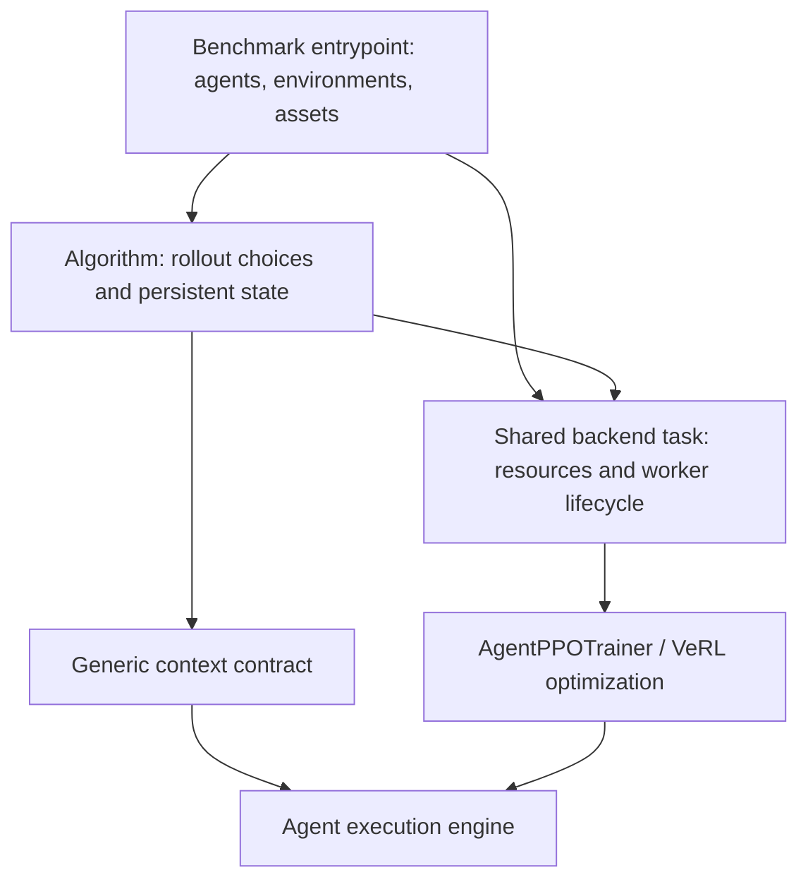

# Architecture and algorithm extensions

The package separates algorithm decisions, backend execution, and benchmark
configuration. Shared algorithm code ships in the wheel; it cannot import an
implementation from `examples`. Examples bind assets and datasets to that code.



## Where code belongs

| Layer | Owns | Does not own |
| --- | --- | --- |
| `rllm/algorithms/<name>` | Rollout/selection strategy, auxiliary credit, schedules, algorithm checkpoint state | Benchmark resource paths, environment installation, globally patched loss semantics |
| `rllm/trainer/verl` | Worker roles/resources, optimization loop, skipped-batch recovery, generic task setup | ACE playbooks or benchmark imports |
| `rllm/context` | Context lifecycle contracts, prompt rendering, batch adaptation | Reflectors, curators, playbook formats |
| `rllm/agents` and `rllm/environments` | Interaction protocols and reusable behaviors | Algorithm selection and credit assignment |
| `examples/<benchmark>*` | Dataset preparation, adapters, exact prompt assets, Hydra binding, launchers | Shared controller implementations |
| `compat/verl` | Exact dependency repair and its provenance | Experimental changes to optimization objectives |

The workflow trainer remains maintained; the upstream SDK, Tinker, and
unified-trainer paths have been removed. The
existing `rllm/experimental` tree has consumers outside ACE; its name is not
evidence that it can be deleted. In particular, maintained PPO entrypoints use
its dynamic-batch and training-output compatibility functions.

## Add a PPO-compatible algorithm

The maintained [baseline recipes](baselines.md) package original ERL in
`rllm/algorithms/erl` and learned-critic PPO bindings in `rllm/algorithms/ppo`.
ERL uses the backend's accepted-batch augmentation hook for mixed GRPO/RAFT
records; variable-record padding and advantage routing remain generic backend
utilities. Delayed joint PPO reuses the packaged ACE controller.

Create `rllm/algorithms/my_algorithm/` with an explicit trainer module. Subclass
`AgentPPOTrainer` for an algorithm that can use the existing PPO/GRPO update
pipeline. The existing extension point `generate_agent_trajectory(timing_raw,
meta_info)` returns `(DataProto, metrics)`; `_transform_agent_trajectories` handles
raw rollout conversion. The base loop owns optimization and checkpoint timing.
For different backend/optimization contracts, use the existing unified trainer
interfaces rather than pretending a rollout override implements a new optimizer.

A benchmark's Ray actor can select the trainer without copying backend setup:

```python
import ray

from rllm.trainer.verl.task import RayAgentTrainer, run_agent_task
from rllm.trainer.verl.train_agent_ppo import TaskRunner


@ray.remote(num_cpus=1)
class MyTaskRunner(TaskRunner):
    def run(self, config, agent_class=None, env_class=None,
            agent_args=None, env_args=None):
        return run_agent_task(
            self,
            config=config,
            trainer_class_path="rllm.algorithms.my_algorithm.trainer.MyTrainer",
            default_agent_class_path="my_benchmark.agent.Agent",
            default_env_class_path="my_benchmark.environment.Environment",
            agent_class=agent_class,
            env_class=env_class,
            agent_args=agent_args,
            env_args=env_args,
            trainer_kwargs={"algorithm_config": dict(config.rllm.my_algorithm)},
        )


# Supply this actor to RayAgentTrainer alongside the benchmark's datasets,
# agent/env classes, and config, then call trainer.train().
```

`MyTrainer` must accept `algorithm_config` in addition to the base constructor
arguments. `trainer_kwargs` cannot override backend-owned arguments such as
`tokenizer`, `config`, worker mappings, or `agent_args`. Configured agent/env
arguments override the benchmark defaults without mutating those defaults.
`RayAgentTrainer` accepts a Ray-decorated actor class through `task_runner_cls`;
this helper covers agent/environment training. Existing workflow entrypoints retain their distinct setup paths.

The shared task resolves the managed cache before model loading, initializes
worker/resource mappings, applies the existing training runtime repairs, and
shuts down on initialization or training failure. Both standard and custom
agent-task paths use the same runtime-patch helper. The latter is an intentional
infrastructure change for ACE, whose former copied task setup omitted those
calls. CPU tests prove routing and call order; driver-side invocation does not
prove patch propagation or recovery inside distributed GPU workers.

Algorithms that discard batches must preserve the base rollout wake/update
lifecycle even when no optimizer step occurs. If algorithm state affects future
samples or decisions, checkpoint it before the parent publishes the latest
marker, restore it from the checkpoint actually loaded, and isolate controller
RNG from validation/iterator construction. ACE demonstrates the complete
implementation; [the checkpoint contract](ace-checkpoint-resume.md) defines its
constraints. Do not infer consumed data from optimizer-step counts.

## ACE as a packaged implementation

| Module | Responsibility |
| --- | --- |
| `rllm.algorithms.ace.trainer_base` | Shared generation, candidate provenance/selection, role credit and metrics |
| `rllm.algorithms.ace.trainer` | Per-task playbooks, standard controller, checkpoint hooks |
| `rllm.algorithms.ace.trainer_iterative` | Role-alternating schedule |
| `rllm.algorithms.ace.trainer_delayed_joint*` | Delayed joint schedule and credit behavior |
| `rllm.algorithms.ace.checkpoint` | Versioned controller sidecar validation and atomic serialization |
| `rllm.algorithms.ace.context` | Playbooks, reflector/curator adaptation and trajectory adapters |
| `rllm.algorithms.ace.evaluation` | Shared evaluation mechanics |
| `rllm.algorithms.ace.entrypoints` | Bind benchmark ACE defaults to the generic backend task |

Controllers retain their existing schedule and reward implementations. They
require explicit `prompts_dir`, `initial_playbook`, `reflector_adapter_class`,
`reflector_system_prompt`, and `curator_system_prompt`. Maintained benchmark
entrypoints provide the old exact defaults. Token-aware adapters opt in through
`reflector_adapter_uses_tokenizer`; an adapter's module name no longer controls
its constructor. `reflector_adapter_kwargs` supplies additional adapter options.

`SingleTurnAgent` and `SingleTurnEnv` in
`rllm.agents.single_turn_agent` and
`rllm.environments.base.prompt_response_env` provide generic prompt/response
behavior. Named ACE roles preserve their old metadata as small subclasses.
The existing reward-driven `SingleTurnEnvironment` remains a separate API.

## Context independent of ACE

Implement `ContextRule` to supply context and consume completed experiences.
`ContextAwareRunner` renders `{{ context }}` (`{{ playbook }}` is an alias),
executes a batch with one snapshot, then invokes trajectory hooks followed by the
batch hook. `run(tasks, adapt=False)` calls no reset/update hooks. A custom
`prompt_renderer(template, context)` can define rendering; `render_in_agent=True`
leaves templates containing task variables to the agent. Unknown template
variables fail instead of being silently erased.

This runner supports `BATCH` updates. `STEP` and `TRAJECTORY` require an engine
with execution-time callbacks and are rejected immediately here. The old
retroactive step callbacks could not affect generated actions. An engine's
`agent_class` is temporarily replaced and restored on exceptions, so do not use
the same engine concurrently in multiple runners.

## Packaging and import boundaries

The foundation import tests run in fresh interpreters while blocking Ray, VeRL,
examples, and optional integrations. Trainer/environment registries and default
tools load on demand. Access `rllm.tools.tool_registry` when you want built-in
tools registered; explicit earlier registrations and later `clear()` calls are
preserved. Importing a parser or context rule no longer loads execution/search
tools. The wheel check imports these APIs away from the checkout and verifies
the packaged Hydra configuration; it does not import full GPU trainers.
